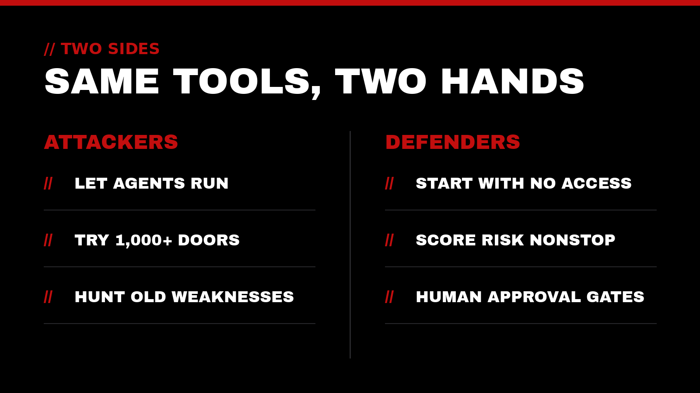
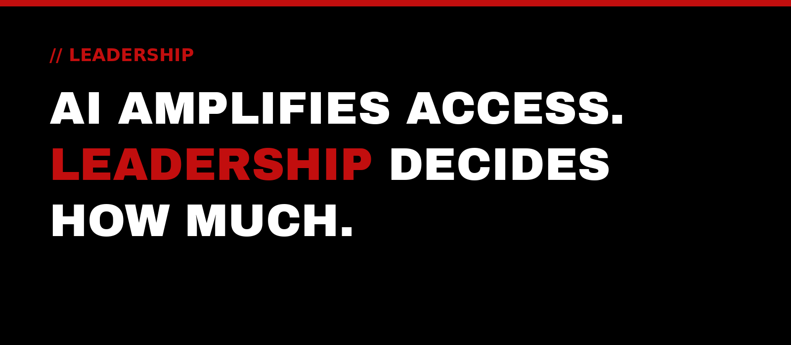

Two stories landed in the same week, and together they say a lot about where technology is heading. In one, attackers pointed autonomous AI agents at company websites and let them work largely on their own. In the other, one of the world's largest software companies rolled out new ways to watch and limit the AI agents that organizations are inviting inside.

Same kind of tool. Very different hands. That's the story we want to talk about this week.

## The attack: agents that break in on their own

On October 19, researchers at the security firm NorForge described a campaign in which criminals used Cairn, an open-source AI tool built for *authorized* penetration testing, to go after company websites without permission. As [The Hacker News reported](https://thehackernews.com/2026/10/hackers-use-autonomous-ai-agents-to.html), the agents tried more than 1,200 sites and reached websites belonging to more than 100 companies, with a focus on online shops and payment systems.

A few details stood out to us:

- **The instructions were short.** According to the reporting, one operator sketched out preferred tactics in fewer than 100 characters, and the agents took it from there.
- **The agents were patient.** Successful break-ins took a little under a day on average, working step by step through whatever weakness they found.
- **The weak spots were ordinary.** One documented intrusion ran through old framework code and a misconfigured session store, not some exotic new technique.

[Dark Reading's coverage](https://www.darkreading.com/cyberattacks-data-breaches/hackers-abuse-ai-pen-test-tool-cairn) put the bigger lesson plainly: AI is widening the pool of targets. Work that once took a skilled person days of attention can now be handed to software that doesn't get tired or bored.

## The response: treat agents like insiders

That same day, Microsoft published [Agents are your newest insiders](https://www.microsoft.com/en-us/security/blog/2026/10/19/agents-are-your-newest-insiders-security-must-move-at-their-speed/), announcing new controls for AI agents working inside organizations. The core idea is simple: an agent should start with no access of its own, receive only what it needs for one task, and lose that access when the task ends. Its risk is scored continuously, and if something looks off, its permissions can be narrowed, switched to read-only, sent for human approval, or shut down.

The post also quotes Microsoft's chairman and CEO, Satya Nadella, with a line we keep coming back to:

> "The most trustworthy agentic system will not be the one with the model we trust most. It will be the one designed that enables us to trust the model least."

That's a security principle, but it's also a stewardship principle. Good systems don't depend on everything going right. They're built so that when something goes wrong, the damage stays small.

## What the two stories have in common

Put side by side, these stories point to the same truth: **AI amplifies access.** In the wrong hands, an agent multiplies how many doors get tried. In the right hands, an agent multiplies how much good work gets done. Either way, the question that matters most is the same one it's always been: *who holds the keys, and how carefully?*

We see three themes worth reflecting on:

1. **Old weaknesses are now cheap to find.** When software can probe a thousand websites patiently, outdated code and forgotten settings stop being low-risk leftovers. Keeping systems current has always mattered. Now it matters at machine speed.
2. **Agents deserve the same care as people.** We'd never hand a new team member every key on day one. AI agents that act on our behalf deserve the same thoughtful approach: clear purpose, limited access, and someone responsible for them.
3. **Visibility comes before control.** You can't protect what you can't see. Knowing which tools and agents are running, and what they can touch, is the starting point for trust.

## Leadership still sets the boundaries

October is Cybersecurity Awareness Month, and this year's campaign from the National Cybersecurity Alliance carries a theme that fits this week perfectly: [Don't Make It Easy for Them](https://www.globenewswire.com/news-release/2026/10/01/3372936/0/en/the-national-cybersecurity-alliance-launches-the-23rd-annual-cybersecurity-awareness-month.html). The habits are not new. What's new is how quickly a missed habit can be found.

At Top-Notch Network, we believe true leadership is the ultimate act of service. Part of serving well is protecting what people have entrusted to us: their information, their time, and their confidence. AI makes that responsibility bigger, not smaller.

> To lead is to serve. To serve is to create value.

## How Top-Notch Network helps

We exist to elevate those who elevate the world. When it comes to AI and security, that looks like:

- **Cybersecurity Auditing:** a clear, honest picture of where you're exposed, including outdated systems and access that's grown over time
- **AI & Automation:** thoughtful adoption of AI tools and agents, with sensible limits on what they can see and do
- **IT & Cloud Consulting:** infrastructure that's reliable, current, and built to support the mission
- **Website & Google Presence Setup:** a web presence the people you serve can find and trust
- **Executive Leadership Coaching:** supporting the leader who carries the weight of these decisions

## Let's talk

If this week's news has you wondering what AI agents mean for your organization, from either side, we'd be glad to listen. A trusted outside perspective to help your impact reach the next level.

Reach out anytime at [contact@top-notchnetwork.com](mailto:contact@top-notchnetwork.com).
