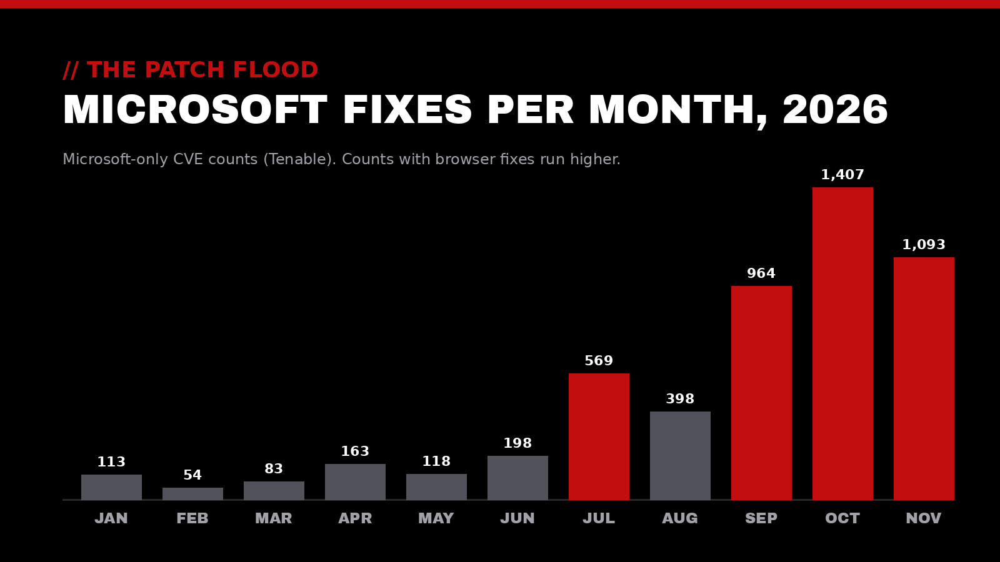
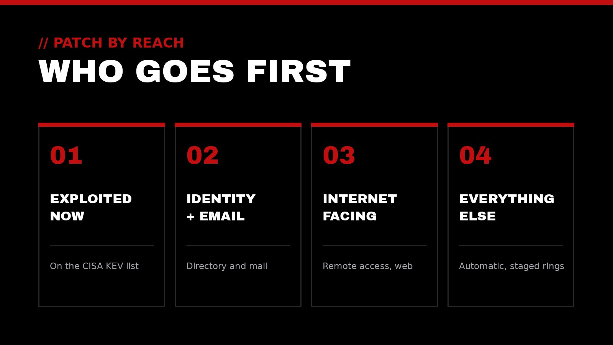

For years, Microsoft's monthly "Patch Tuesday" was a predictable routine: a hundred or so fixes, a few urgent ones, and a normal maintenance window. That routine is gone. This week's release, on Nov 10, fixed more than 1,000 vulnerabilities, right after October set an all-time record.

Windows isn't suddenly worse. The people hunting for flaws, on both sides, now have AI. Here's a plain-language look at what's happening, why the window to respond is shrinking, and how to keep pace without burning out the people who keep systems running.

## // 01 What changed

The numbers tell the story. Early in 2026, a typical Patch Tuesday fixed somewhere between 50 and 200 Microsoft vulnerabilities. Starting in July, that number jumped, and it hasn't come back down. Tenable's Microsoft-only counts, [as compiled by WorkspaceDNA](https://www.workspacedna.com/blog/patch-tuesday-crossed-1000-cves.-ai-is-why-and-it-isnt-slowing-down), went from 113 in January to 1,407 in October and 1,093 in November. Counts that include browser fixes run higher: BleepingComputer [tallied](https://www.bleepingcomputer.com/news/microsoft/microsoft-november-2026-patch-tuesday-fixes-1-235-flaws-outlook-zero-day/) 1,411 in October and 1,235 this month.

The main driver is AI-assisted discovery. Microsoft [explained](https://www.microsoft.com/en-us/msrc/blog/2026/05/a-note-on-patch-tuesday) that its own engineers and outside researchers are increasingly using AI to examine code "more carefully and more often" than was practical before. Its agentic scanner, called MDASH, [coordinates more than 100 specialized AI agents](https://www.microsoft.com/en-us/security/blog/2026/05/12/defense-at-ai-speed-microsofts-new-multi-model-agentic-security-system-tops-leading-industry-benchmark/) to find bugs, debate whether they're real, and prove they can be exploited.

That's good news in one important sense. As Microsoft [put it](https://blogs.windows.com/windowsexperience/2026/11/05/a-new-standard-for-vulnerability-management-in-the-ai-era/) last week, more CVEs doesn't mean Windows got less secure. It means more holes are being found and closed.

## // 02 Why the clock is shorter

There's a catch. The same tools that help defenders find flaws also help attackers study a fix once it's published and work backward to an exploit. Microsoft's Nov 5 post says this can now happen "potentially within hours."

Meanwhile, many organizations still take weeks to install updates. Microsoft's own data from August showed that fewer than half of measured enterprise Windows devices had installed the security update two weeks after release, and about one in four still didn't have it after four weeks. That gap between "the fix exists" and "the fix is installed" is where the risk lives.

This month offers a clear example. The one flaw already being exploited, [CVE-2026-124194](https://blog.qualys.com/vulnerabilities-threat-research/2026/11/10/microsoft-patch-tuesday-november-2026-security-update-review) in Microsoft Outlook, is rated only moderate. But if a user opens a booby-trapped message file, Outlook can quietly hand an attacker authentication information that can be used to impersonate that user. The U.S. Cybersecurity and Infrastructure Security Agency added it to its Known Exploited Vulnerabilities catalog with a Nov 24 deadline for federal agencies. A severity score alone would have ranked it low on the list.

## // 03 Where to focus first

When there are a thousand fixes a month, reading each one isn't realistic. The good news: Windows updates are cumulative, so the real decision isn't *which fixes* to install but *which devices go first*. Microsoft recommends starting with internet-facing systems, identity infrastructure, and high-value assets.

In practice, a sensible order looks like this:

1. **Anything already being exploited.** Check the [CISA KEV catalog](https://www.cisa.gov/known-exploited-vulnerabilities-catalog) each month. This month, that means Outlook.
2. **Identity and email.** Domain controllers and mail servers hold the keys. This month's critical fixes include a Windows LDAP flaw that puts domain controllers at risk and an Exchange Server flaw that lets an attacker with a valid sign-in run code on the server.
3. **What faces the internet.** Remote access, web servers, and anything reachable from outside.
4. **Everyone else, promptly.** Laptops and desktops on an automatic, staged schedule rather than a manual one.

## // 04 Keeping pace for the long run

This isn't a one-month spike. AI-driven discovery is speeding up, not slowing down, so the goal is a patching rhythm that holds up at this new volume:

- **Measure in days, not cycles.** Track how many days it takes for an update to reach most devices. That one number shows whether the process is keeping up.
- **Let automation carry the routine.** Tools like Windows Autopatch, staged rings, and hotpatching (updates without a restart, on eligible systems) reduce disruption and free people for the judgment calls.
- **Test smart, not slow.** A small pilot group that gets updates first catches most problems without holding back everyone else.
- **Stay on supported versions.** Systems that no longer receive updates can't benefit from any of this.
- **Keep a plan B.** Good backups, endpoint detection, and a clear response plan matter more when the window is short.

> The fix only protects you once it's installed.

## How Top-Notch Network helps

Top-Notch Network exists to elevate those who elevate the world. When the pace of change speeds up, that means helping service-driven leaders and organizations stay protected without losing focus on the people they serve:

- **Cybersecurity Auditing:** a clear picture of where patching gaps, exposed systems, and identity risks actually are
- **IT & Cloud Consulting:** update processes, automation, and infrastructure that keep pace reliably
- **AI & Automation:** putting AI to work on the defender's side, with sensible guardrails and human review
- **Executive Leadership Coaching:** supporting leaders as they set priorities in a faster-moving risk landscape

## Let's talk

If this month's update volume felt overwhelming, or you're not sure how quickly fixes reach your devices, we'd be glad to talk it through. We offer a trusted outside perspective to help your impact reach the next level.

Reach out anytime at [contact@top-notchnetwork.com](mailto:contact@top-notchnetwork.com).
