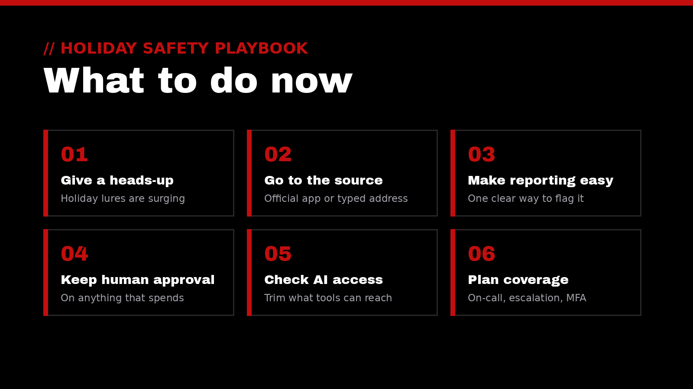

Black Friday is almost here, and so is one of the busiest stretches of the year for scams. This week, security researchers and consumer officials have described a sharp rise in shopping-themed phishing and a new twist: AI is making fake shops, reviews, and messages look more convincing than ever, and in some cases it's being used to steer AI assistants toward them.

This matters at work as much as at home. Holiday lures land in business inboxes, people shop and track packages on the same devices they use for work, and more teams now rely on AI tools that read web pages and sometimes act on what they find. Here's a plain-language look at what changed and the steps that help most.

## // 01 What the research shows

On Nov 24, Darktrace published [an analysis](https://www.darktrace.com/blog/black-friday-phishing-rises-more-than-1-200-ahead-of-holiday-shopping-weekend) of phishing seen across the organizations it protects. Its key findings:

- **Daily volume jumped.** Between Nov 1 and 21, Black Friday phishing averaged more than 13 times the daily volume seen in October, the increase behind the "more than 1,200%" headline.
- **The surge is still building.** In the six days to Nov 21, daily volumes were nearly three times those of the week before.
- **Businesses are a target.** Among businesses in the US and Canada, Black Friday phishing in the week beginning Nov 16 reached nearly 27 times the October weekly average.
- **It arrives in bursts.** Among businesses receiving significant volumes, half got at least 85% of their Black Friday phishing on just three days.
- **Big brands are the costume.** Among phishing emails impersonating Amazon, Apple, eBay, Netflix, Alibaba, and PayPal, nearly one in eight were flagged as likely Black Friday-related during Nov 16 to 21, compared with 0.3% in October.

Darktrace also notes that being impersonated doesn't mean a brand's own systems were compromised. Attackers can copy a name, logo, and promotional style without ever touching the real retailer.

## // 02 Why AI makes this harder

The old warning signs, such as clumsy grammar, blurry photos, and odd layouts, are fading. [Bitdefender](https://www.bitdefender.com/en-us/blog/hotforsecurity/ai-fake-shops-black-friday-cyber-monday-shopping-safety), writing on Nov 23 about a warning from DNS Belgium, notes that AI can produce professional-looking stores with persuasive descriptions, realistic images, and believable reviews in minutes. It also found that half of the Black Friday-themed email campaigns it observed between Oct 30 and Nov 10 were marked as scams.

The bigger shift is that scammers are aiming at AI tools, not just people:

- **Poisoned recommendations.** [The Guardian reported](https://www.theguardian.com/money/2026/nov/22/black-friday-scam-deals--ai-fake-storefront) on Nov 22 that the UK's National Trading Standards says criminals are "poisoning" AI models so they recommend scam websites. A security founder quoted in the piece explained that scams reach AI agents the same way they reach people: through search results, paid ads, compromised sites, and social posts.
- **Hidden instructions.** Darktrace warns that attackers can plant instructions inside web pages to manipulate an AI system's recommendations or actions, a technique known as prompt injection. When several fake pages praise the same seller, repetition can look like independent confirmation.
- **Officials are taking notice.** On Nov 24, the New York Attorney General's [holiday consumer alert](https://ag.ny.gov/press-release/2026/attorney-general-james-issues-tips-new-yorkers-avoid-holiday-shopping-scams) specifically urged caution with AI tools: limit what accounts and personal information they can reach, set clear spending limits, and require human approval before purchases whenever that option is available.

The lesson isn't to avoid AI. It's to treat what an AI tool recommends as a lead, not proof.

## // 03 What leaders and IT teams can do now

None of this calls for panic. A few steady habits cover most of the risk through the holiday season:

1. **Give people a heads-up.** A short, friendly note that holiday phishing is surging, and that delivery problems, refund offers, and "exclusive deal" messages are favorite lures, goes a long way. Keep it about awareness, not blame.
2. **Go to the source, not the link.** Encourage everyone to check orders, deliveries, and refunds through the retailer's official app or a web address they type themselves, rather than through a link in an email, text, or ad.
3. **Make reporting easy.** One clear way to report a suspicious message, plus a quick thank-you when someone does, turns your team into an early warning system. Because these campaigns arrive in bursts, fast reporting helps IT block a wave early.
4. **Keep human approval on anything that spends or shares.** If AI assistants or automations can make purchases, issue refunds, change orders, or reach customer data, set limits and require a person to approve high-impact actions.
5. **Check what your AI tools can reach.** Review which accounts, data, and payment methods each AI tool or agent can access, and trim anything it doesn't need.
6. **Plan for quieter coverage.** Holidays often mean lighter staffing. Confirm who's on call, how incidents get escalated, and that multi-factor authentication is on for email and admin accounts before the long weekend.

## // 04 The leadership lesson

Scams succeed when urgency beats judgment. Darktrace makes a useful point: legitimate retailers use countdown timers and low-stock warnings too, so urgency alone can't tell a real offer from a fake one. What helps is a culture where pausing is normal.

- **Model the pause.** When leaders say "let me verify that first," it gives everyone else permission to do the same.
- **Reward the report, not the perfect record.** People who flag a message they almost clicked are doing exactly the right thing.
- **Keep people in the loop on AI.** Tools that act quickly are valuable, and they work best with clear limits and a human check on decisions that matter.

> A ten-second pause is still one of the strongest security controls there is.

## How Top-Notch Network helps

Top-Notch Network exists to elevate those who elevate the world. Through a busy, high-risk season, that means helping service-driven leaders and organizations protect their people and keep serving them well:

- **Cybersecurity Auditing:** a clear view of phishing exposure, email protections, multi-factor authentication coverage, and how incidents are reported and escalated
- **IT & Cloud Consulting:** email and identity settings, on-call coverage, and continuity planning built for lighter holiday staffing
- **AI & Automation:** reviewing what your AI tools and agents can access and approve, with sensible limits and human checks
- **Executive Leadership Coaching:** supporting leaders as they build calm, security-minded cultures where pausing to verify is the norm

## Let's talk

If this season's scams have you wondering how ready your team is, or you'd like a second look at how your AI tools are set up, we'd be glad to talk it through. We offer a trusted outside perspective to help your impact reach the next level.

Reach out anytime at [contact@top-notchnetwork.com](mailto:contact@top-notchnetwork.com).
