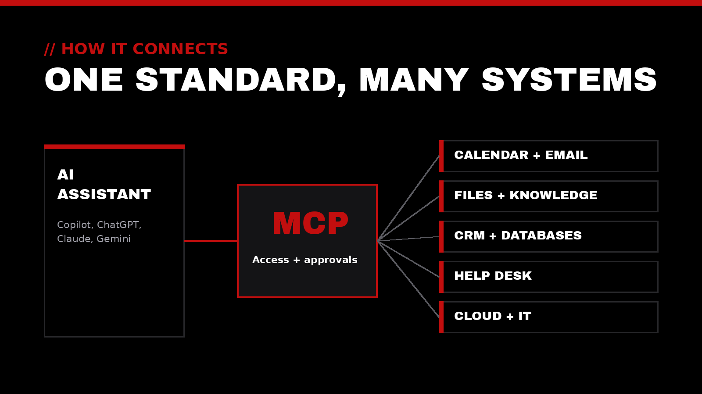
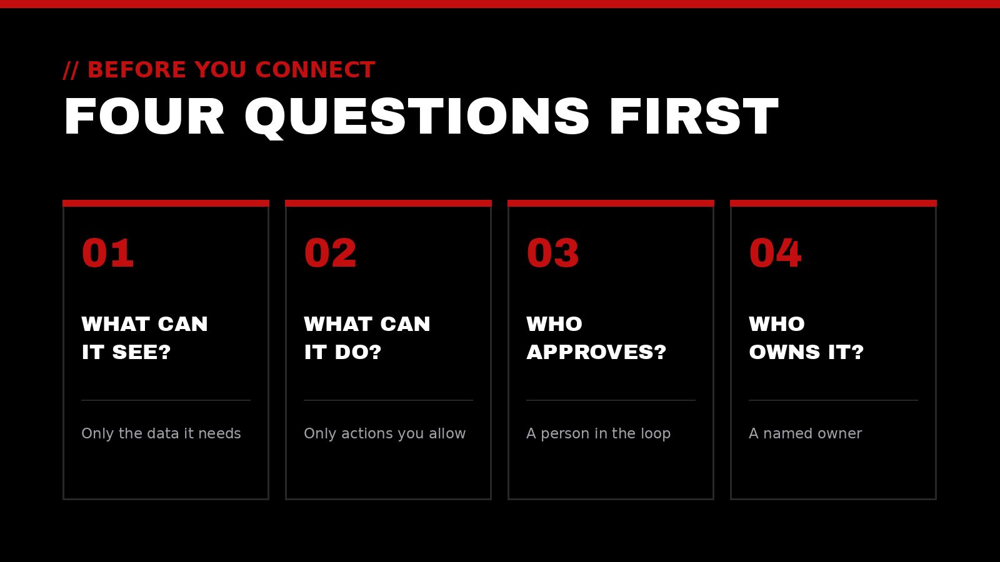

Most of the AI news cycle is about which model is smartest this month. The change that may matter more is quieter: how AI assistants connect to the tools and information people already use. More and more, the answer is an open standard called the **Model Context Protocol**, or MCP.

This week alone brought a run of announcements built on it, from cloud platforms to customer-experience software to large engineering teams. Here's a plain-language look at what MCP is, why it's catching on, and what it means for leaders who want AI to serve their people well.

## // 01 What MCP is

MCP is an open-source standard for connecting AI applications to outside systems such as files, databases, calendars, and business software. The project's own [introduction](https://modelcontextprotocol.io/docs/getting-started/intro) compares it to a USB-C port for AI: one common connector instead of a different cable for every device.

Before a standard like this, every AI tool needed its own custom integration with every system it touched. With MCP, a system is described once, through what's called an MCP server, and any AI assistant that speaks MCP can use it. That's why you'll increasingly see "connectors" or "plugins" inside AI assistants. Many of them run on MCP underneath.

It's also not owned by a single vendor anymore. In December 2025, Anthropic, which created MCP, [donated it to the Agentic AI Foundation](https://www.linuxfoundation.org/press/linux-foundation-announces-the-formation-of-the-agentic-ai-foundation), a neutral home under the Linux Foundation backed by AWS, Google, Microsoft, OpenAI, Cloudflare, Bloomberg, and others. At that point the Linux Foundation counted more than 10,000 published MCP servers, with support in ChatGPT, Claude, Gemini, Microsoft Copilot, and VS Code.

## // 02 Why it's spreading now

A few announcements from just the past several days show how fast MCP is moving from developer experiment to everyday infrastructure:

- **Cloud contact centers:** AWS announced on Nov 2 that [Amazon Connect flows can now call MCP tools](https://aws.amazon.com/about-aws/whats-new/2026/10/connect-flows-mcp-tools/), so a customer call can pull context like case history from another system without custom code.
- **Live business data:** MongoDB made a [connector generally available](https://www.mongodb.com/company/blog/product-release-announcements/bring-live-atlas-data-into-microsoft-365-copilot) on Nov 3 that lets Microsoft 365 Copilot answer questions from live database records through MCP, instead of a stale copy.
- **Marketing and customer experience:** Adobe said on Nov 4 that its [CX Enterprise Coworker](https://news.adobe.com/news/2026/11/adobe-integrates-agentic-cx-enterprise-coworker-into-ai-platforms) is now available inside ChatGPT, Claude, Gemini, and Microsoft Copilot, with ready-made MCP connectors to partner tools.
- **At scale, with guardrails:** InfoQ [reported](https://www.infoq.com/news/2026/11/uber-mcp-gateway-ai-agents/) on Nov 2 that Uber built a central gateway governing more than 800 MCP servers and more than 5,000 tools. Newly discovered tools stay disabled until the team that owns them reviews and turns them on.

The pattern is clear. Software makers are building MCP in so that their products work with whichever AI assistant their customers already use.

## // 03 Where it helps

The real value isn't a clever chatbot. It's less copying and pasting between systems, so people can spend their attention on the people they serve. That's what we call *utility optimization*: removing the noise so the work that matters gets more time.

Some practical examples of what MCP connections make possible:

- Asking an assistant to summarize this week's support tickets and draft the follow-ups, pulling from the help desk directly.
- Getting answers from a shared drive or knowledge base with links back to the source documents.
- Preparing for a meeting with the calendar invite, the related email thread, and the account notes gathered in one place.
- Letting IT staff check system status or look up a configuration without jumping between five consoles.

## // 04 Adopting it with care

Connecting an AI assistant to real systems is powerful because it gives that assistant real access. The more it can reach, the more it matters that someone has thought about the limits. The MCP project publishes its own [security best practices](https://modelcontextprotocol.io/docs/tutorials/security/security_best_practices), and the U.S. National Institute of Standards and Technology offers the free [AI Risk Management Framework](https://www.nist.gov/itl/ai-risk-management-framework) for thinking about AI risk in general.

Before turning on a new connector, four questions go a long way:

1. **What can it see?** Give each connection only the data it needs. Read-only is a fine place to start.
2. **What can it do?** Know which actions, like sending, deleting, or changing records, the assistant can take on its own.
3. **Who approves?** Keep a person in the loop for anything that leaves the organization or can't be undone.
4. **Who owns it?** Keep a simple list of which connectors are on, who turned them on, and who reviews them. Uber's "off until the owner enables it" rule is a good model at any size.

It's also worth sticking to connectors from vendors you already trust, or from official directories, rather than installing whatever turns up in a search.

> Connect what serves the mission. Limit what doesn't.

## How Top-Notch Network helps

Top-Notch Network exists to elevate those who elevate the world. In practice, that means helping service-driven leaders and organizations adopt new technology in a way that's useful and safe:

- **AI & Automation:** choosing and connecting AI tools thoughtfully, with sensible guardrails and human review where it counts
- **Cybersecurity Auditing:** a clear picture of what your AI tools and connectors can reach, and where access should be tightened
- **IT & Cloud Consulting:** infrastructure and integrations that are reliable, secure, and built to support the mission
- **Executive Leadership Coaching:** supporting the leader who sets the direction for how these tools are used

## Let's talk

If your team is starting to connect AI assistants to everyday tools, or you're wondering whether you should, we'd be glad to talk it through. We offer a trusted outside perspective to help your impact reach the next level.

Reach out anytime at [contact@top-notchnetwork.com](mailto:contact@top-notchnetwork.com).
