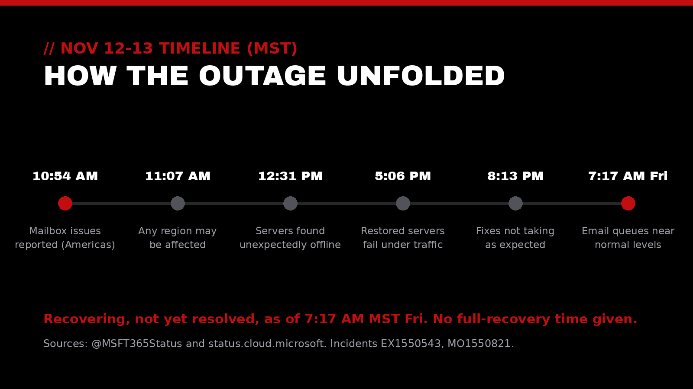
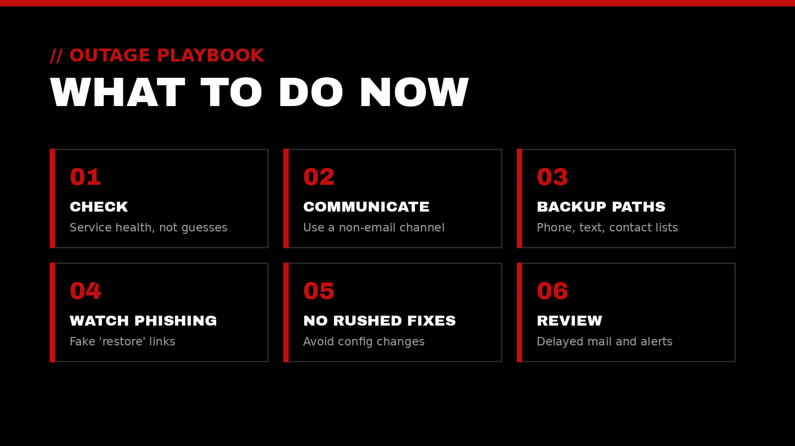

On Thursday, Nov 12, many organizations opened Outlook and found nothing would load. A Microsoft 365 outage centered on Exchange Online, the service behind business email and calendars, left users unable to reach their mailboxes and spread into Teams, Copilot, and other tools that depend on it. As of early Friday morning, Microsoft reported steady recovery but had not declared the outage resolved.

Here's a plain-language look at what happened, where things stand, and the steps that help most while a core service is down.

## // 01 What happened

Microsoft's [Microsoft 365 Status](https://x.com/MSFT365Status/status/2120938282204688468) account first reported mailbox problems in the Americas at 10:54 AM MST and, 13 minutes later, said users [in any region](https://x.com/MSFT365Status/status/2120941584220827979) could be affected. The issue is tracked as **EX1550543** for Exchange Online and **MO1550821** for the wider set of Microsoft 365 services. Admin center listings shared by organizations such as [Old Dominion University](https://status.odu.edu/incidents/93) show the Exchange incident opening earlier, at 9:17 AM MST.

Reports climbed fast. Downdetector logged nearly 130,000 problem reports around 11:00 AM MST, according to the [Guardian](https://www.theguardian.com/technology/2026/nov/13/microsoft-outage-outlook-teams-word-excel-reports) and [AP](https://apnews.com/article/microsoft-outlook-outage-email-teams-6376045281feb430c0b923e3a4b251c2). The Guardian said those reports came from 74 countries. The [BBC](https://www.bbc.com/news/articles/c5gm3g9ldz8xo) put the Outlook peak at nearly 140,000.

The impact followed Exchange Online. Microsoft said users might not be able to reach mail through [Outlook on the web, Outlook desktop, mobile sync, or REST connections](https://status.cloud.microsoft/), and that mail could arrive late. Features that rely on email and calendars were also hit, including Teams scheduling, Copilot, Defender for Office 365, Intune, and Purview. Core Teams features such as calls, meetings, and chats stayed [largely functional](https://www.bbc.com/news/articles/c5gm3g9ldz8xo).

As for the cause, Microsoft first pointed to elevated load, then [clarified](https://x.com/MSFT365Status/status/2120962673911181437) that it wasn't driven by more traffic but by "a number of servers being unexpectedly unavailable," which strained the rest. Later it said [a core process on affected servers](https://x.com/MSFT365Status/status/2121002505911857577) was becoming overwhelmed. Microsoft has said it is [not aware of any malicious activity](https://www.cnbc.com/2026/11/12/microsoft-outage-outlook-aws-google.html) and will publish a full root cause in a Post-Incident Report once service is restored.

## // 02 Where things stand

**As of 7:57 AM MST Friday, Nov 13**, Microsoft said it was "observing sustained improvements in service availability as recovery progresses across affected Microsoft 365 services." It added that some users may still experience intermittent connectivity issues or delayed email delivery, that its efforts are increasingly focused on resolving remaining issues and restoring consistent service, and that it is validating recovery across connection methods and monitoring stability. Microsoft said it has no evidence of malicious activity and will publish a Post-Incident Report after mitigation is complete. Its [public status page](https://status.cloud.microsoft/) still listed "Service degradation" for both incidents, so the outage was not declared resolved, and Microsoft's next update was due by 9:00 AM MST. The earlier 7:17 AM MST update on X had said service availability was continuing to improve, with [email queues significantly reduced and approaching normal levels](https://x.com/MSFT365Status/status/2121246073955962896). Recovery was uneven overnight. Servers brought back in the afternoon [could become unresponsive again](https://x.com/MSFT365Status/status/2121031935010951521) once traffic returned, and at 8:13 PM MST Microsoft said its changes were "[not taking as expected](https://x.com/MSFT365Status/status/2121079061774491735)." By 9:36 PM MST it reported [partial recovery](https://x.com/MSFT365Status/status/2121099952633840043). Early Friday, Microsoft [said](https://x.com/MSFT365Status/status/2121172248241348867) it was seeing early stabilization and had extended the email timeout to 48 hours to help preserve delayed mail. By 4:11 AM it reported [actions completed](https://x.com/MSFT365Status/status/2121199246959378803) across portions of the affected infrastructure, and at 6:32 AM [continued recovery](https://x.com/MSFT365Status/status/2121234739562450970) in North America, Europe, and Asia Pacific. Microsoft has not given a time for full recovery.

Conditions may have changed by the time you read this. The live sources are the **Service health** page in the Microsoft 365 admin center, [status.cloud.microsoft](https://status.cloud.microsoft/) if the admin center won't load, and [@MSFT365Status](https://x.com/MSFT365Status) on X.

## // 03 What leaders and IT teams can do now

The goal during an outage is steady communication and fewer surprises, not quick fixes. A few steps help most:

1. **Watch the official sources.** Track EX1550543 and MO1550821 in Service health. That shows whether a problem is on Microsoft's side before anyone spends hours troubleshooting local systems.
2. **Tell people early, and through another channel.** If email is down, an email announcement won't land. A short text, Teams chat (which stayed largely available), or intranet note can explain what's affected and when the next update is coming.
3. **Use backup channels for anything urgent.** Phone, text, and alternate contact lists keep time-sensitive work moving with customers, partners, and staff.
4. **Watch for outage-themed phishing.** Scammers follow the headlines. Officials in Australia's state of Victoria [urged people](https://www.theguardian.com/technology/live/2026/nov/13/microsoft-outage-down-today-live-update-outlook-teams-365-when-fixed-latest-status-cause-news) to watch for opportunistic scams during this outage. Be wary of "restore your mailbox" links, fake sign-in pages, and callers claiming to be from Microsoft or IT.
5. **Hold off on rushed changes.** Resetting profiles, changing mail routing, or reconfiguring security settings in the middle of a provider outage can create new problems that last after Microsoft recovers.
6. **Review afterward.** Once service returns, check for delayed mail and for security alerts or automated actions that may have been held up. Then capture what worked and what didn't.

## // 04 The resilience lesson

Cloud services are very reliable, but no single provider is perfect, and this week showed how much daily work runs through one inbox. The organizations that got through Thursday most calmly were usually the ones that had already answered a few simple questions:

- **What's our plan B for email?** Who gets notified, how, and from which contact list if the directory itself is unreachable?
- **Which processes depend on email without anyone noticing?** Approvals, alerts, invoicing, and sign-in codes often do.
- **Is our continuity plan written down and tested?** A plan that lives in a mailbox isn't much help when the mailbox is down.
- **Who owns communication during an incident?** Clear roles reduce noise and keep updates consistent.

> Outages are rare. Being ready for one shouldn't be.

## How Top-Notch Network helps

Top-Notch Network exists to elevate those who elevate the world. When a core service goes down, that means helping service-driven leaders and organizations stay steady and keep serving their people:

- **Cybersecurity Auditing:** a clear view of single points of failure, phishing exposure, and how security tools behave when a provider is down
- **IT & Cloud Consulting:** continuity planning, backup communication paths, and Microsoft 365 configurations built for resilience
- **AI & Automation:** reviewing which automations and AI tools depend on email and calendar data, with sensible fallbacks
- **Executive Leadership Coaching:** supporting leaders as they communicate calmly and make clear decisions during disruptions

## Let's talk

If Thursday's outage showed gaps in your plan B, or you'd like a second look at how your organization would handle the next one, we'd be glad to talk it through. We offer a trusted outside perspective to help your impact reach the next level.

Reach out anytime at [contact@top-notchnetwork.com](mailto:contact@top-notchnetwork.com).
