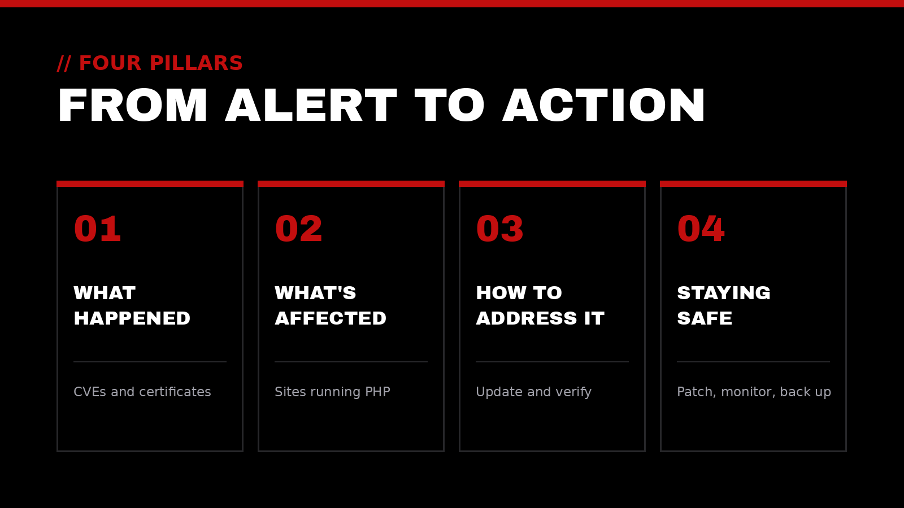
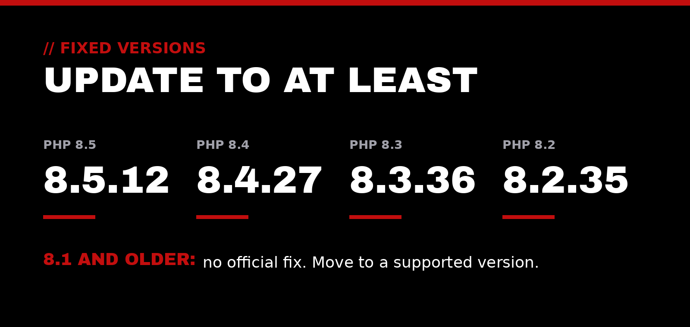

PHP is the programming language behind a large share of the web, quietly powering content management systems, online stores, and custom applications. This week, the PHP project released emergency updates for two critical flaws, and government security agencies urged organizations to patch right away.

They follow a September release that fixed bugs in how PHP checks security certificates. Here's our plain-language breakdown in four parts.

## // 01 What happened

On October 21, the PHP project released PHP 8.5.12, 8.4.27, 8.3.36, and 8.2.35. Its [security advisory](https://www.php.net/archive/2026.php) describes two critical vulnerabilities, each rated 9.2 out of 10 under CVSS v4.0, that can allow **unauthenticated remote code execution**. The U.S. Cybersecurity and Infrastructure Security Agency, which refers to the pair as "php2shell," issued an [alert](https://www.cisa.gov/news-events/alerts/2026/10/21/critical-vulnerabilities-php-require-immediate-patching) urging immediate patching.

- **CVE-2026-109618** ([advisory](https://github.com/php/php-src/security/advisories/GHSA-w8hw-w9fx-j79w)): if a request runs PHP out of memory at the wrong moment, PHP can leave half-built data behind and later treat it as valid. On Apache with mod_php, this can be triggered before any website code runs.
- **CVE-2026-109619** ([advisory](https://github.com/php/php-src/security/advisories/GHSA-6wmf-4rv5-p3rp)): an error at the wrong point can leave PHP holding onto memory from a previous visitor's request, which a later request can then misuse.

At the time of its alert, CISA said it had not seen these flaws being exploited. [CERT-EU](https://www.cert.europa.eu/publications/security-advisories/2026-018/) has since reported that proof-of-concept code is circulating, which makes attacks more likely.

**The certificate issue.** Certificates are how a server proves it is who it claims to be. In September, PHP 8.5.11, 8.4.26, 8.3.35, and 8.2.34 fixed two bugs in how PHP checks them when connecting out to services such as payment gateways or APIs:

- **CVE-2026-91769** ([advisory](https://github.com/php/php-src/security/advisories/GHSA-vvx9-73fr-5jjx)): PHP could accept a certificate issued for a different name, which could let one server impersonate another.
- **CVE-2026-91767** ([advisory](https://github.com/php/php-src/security/advisories/GHSA-xr7j-rvgx-xq5p)): a specially crafted certificate could make PHP read past its memory and crash.

The same September release also fixed **CVE-2026-91766** ([advisory](https://github.com/php/php-src/security/advisories/GHSA-fpwc-w8rq-cr92)). PHP could forward login tokens or cookies to a different site when following a redirect.

| CVE | What it is | Severity | Fixed in |
|---|---|---|---|
| CVE-2026-109618 | Remote code execution via out-of-memory corruption | Critical, 9.2 (CVSS v4.0) | 8.5.12, 8.4.27, 8.3.36, 8.2.35 |
| CVE-2026-109619 | Remote code execution via stale memory between requests | Critical, 9.2 (CVSS v4.0) | 8.5.12, 8.4.27, 8.3.36, 8.2.35 |
| CVE-2026-91769 | Certificate name check accepts the wrong name | Moderate, 4.3 (CVSS v3.1) | 8.5.11, 8.4.26, 8.3.35, 8.2.34 |
| CVE-2026-91767 | Crafted certificate causes out-of-bounds read | Moderate, 6.5 (CVSS v3.1) | 8.5.11, 8.4.26, 8.3.35, 8.2.34 |
| CVE-2026-91766 | Credentials leaked on cross-site redirects | Moderate, 5.9 (CVSS v3.1) | 8.5.11, 8.4.26, 8.3.35, 8.2.34 |

The good news: the October releases include the September fixes, so one update covers all five.

## // 02 What's affected

These flaws live in PHP itself, not in any one website product. According to PHP, every installation that serves web requests is at risk, including PHP-FPM, Apache with mod_php, php-cgi, FrankenPHP, and LiteSpeed. Common platforms that run on PHP include:

- **WordPress:** the most widely used website builder and blogging platform. [WordPress.org](https://wordpress.org/news/2026/10/critical-php-security-release/) says no WordPress update is needed; the fix is updating PHP.
- **Drupal:** a content management system often used by larger organizations and public agencies. [Drupal's notice](https://www.drupal.org/psa-2026-10-20) likewise points to updating PHP.
- **Magento / Adobe Commerce, WooCommerce, and Joomla:** online store and website platforms that run on PHP and are exposed when PHP is unpatched, as [GoDaddy](https://www.godaddy.com/resources/news/important-php-security-update-what-website-owners-need-to-do) and [Vercel](https://vercel.com/kb/bulletin/php2shell-security-bulletin) note.
- **Laravel:** a popular framework for building custom web applications. Laravel has [patched Laravel Cloud](https://laravel.com/blog/php-critical-vulnerability-response-updates), while [Forge](https://laravel.com/forge/docs/knowledge-base/php-security-release-october-2026) users must click "Update PHP" on each server.
- **cPanel & WHM:** the control panel many web hosts use to manage servers. [cPanel](https://support.cpanel.net/hc/en-us/articles/44397389677335-Critical-PHP-Security-Release-CVE-2026-109618-and-CVE-2026-109619) has released patched EasyApache 4 PHP packages, including backports for PHP 7.4, 8.0, and 8.1.

Affected versions: PHP 8.5.0–8.5.11, 8.4.0–8.4.26, 8.3.0–8.3.35, and 8.2.0–8.2.34. PHP 8.1 and older no longer receive official fixes, and [AWS](https://aws.amazon.com/security/security-bulletins/2026-143-aws/) notes that a supported branch is required. Updating your theme, plugins, or application code alone won't fix this.

## // 03 How to address it

1. **Find every PHP site and server.** PHP is often built into other software, so it isn't always obvious where it runs.
2. **Check the version that serves web pages.** In WordPress, go to Tools > Site Health > Info > Server. On a server, the command-line version can differ from the web version.
3. **Take a backup, then update** to 8.5.12, 8.4.27, 8.3.36, or 8.2.35 or newer, through your host, control panel, or operating system packages.
4. **Restart PHP and the web server** so the update actually takes effect, then confirm the new version.
5. **If you're on PHP 8.1 or older,** plan a move to a supported version now. CISA and WordPress.org both advise considering taking unpatched systems offline until they're fixed.
6. **Confirm certificate checks are on.** Make sure custom code and integrations don't turn off `verify_peer` or `verify_peer_name`. Switching those off removes the protection the September fixes strengthened.
7. **Can't patch today?** PHP's advisory lists temporary settings, such as disabling `session.upload_progress.enabled`, that reduce exposure. PHP is clear that they're incomplete; only the update fully fixes the problem.

## // 04 Staying safe going forward

- **Keep a patch rhythm.** PHP ships security releases roughly monthly. A regular update window, plus a fast path for emergencies like this one, keeps you ahead.
- **Monitor certificates.** Track expiration dates and renewals, and alert on failures instead of disabling checks to make an error go away.
- **Keep an inventory.** Know which sites, servers, and versions you run, who hosts each, and when each PHP branch reaches end of life. PHP 8.2 stops receiving security fixes on December 31.
- **Test your backups.** A backup only counts once you've restored from it.
- **Watch the logs.** CISA recommends looking for PHP processes launching shells or downloading tools.

> Good stewardship means caring for the foundation, not just the front door.

## How Top-Notch Network helps

We exist to elevate those who elevate the world. In practice, that means helping service-driven leaders and organizations keep their systems patched, secure, and dependable:

- **IT & Cloud Consulting:** infrastructure that's reliable, secure, and built to support the mission
- **Cybersecurity Auditing:** a clear picture of where you're exposed, including how you sign in and protect accounts
- **Website & Google Presence Setup:** making sure the people you serve can find you and find accurate information
- **AI & Automation:** thoughtfully adopting AI tools and automations that remove noise, with sensible guardrails
- **Executive Leadership Coaching:** supporting the leader who supports everyone else

## Let's talk

If you're not sure which PHP version your site runs, or whether this update reached it, we'd be glad to help you check. A trusted outside perspective to help your impact reach the next level.

Reach out anytime at [contact@top-notchnetwork.com](mailto:contact@top-notchnetwork.com).
