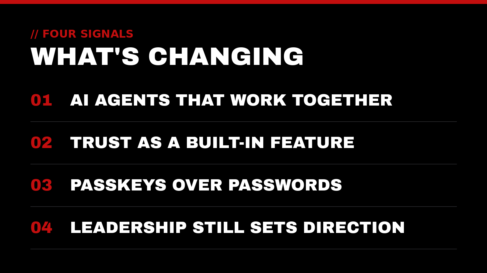
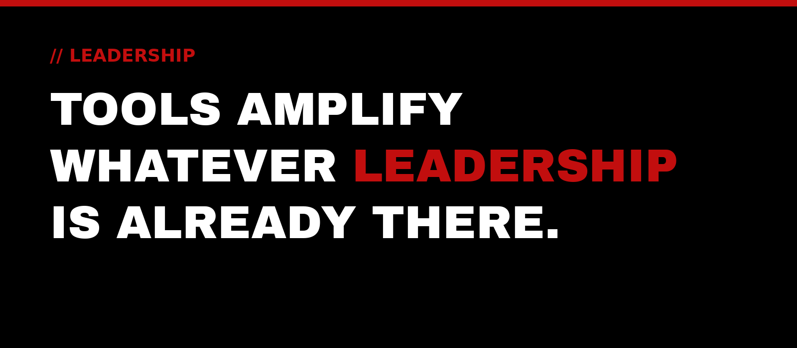

Every year brings a new wave of tools, acronyms, and predictions. Most of it is noise. A few things, though, really do change how service-driven leaders work. They change how they protect the people in their care, and how much of their time goes to the work that matters most.

This is our first post on the Top-Notch Network blog, so we wanted to start with the big picture: four signals we're watching across technology, AI, and leadership, and how we think about each one through a stewardship lens.

## 1. AI is moving from answers to action

For the last few years, most people met AI as a chat window: ask a question, get an answer. The next step is AI that can carry out multi-step work. Industry analysts now describe *multiagent systems*, meaning groups of specialized AI agents that collaborate on complex tasks. Gartner lists them among its [Top Strategic Technology Trends for 2026](https://www.gartner.com/en/articles/top-technology-trends-2026).

What we find meaningful here isn't the novelty. It's the promise of handing repetitive, low-value tasks to systems so people can give their attention to people. That's what we call *utility optimization*: streamlining operations to remove the noise and prioritize high-level service.

The other side of that promise is responsibility. An agent that can act can also act wrongly. The more work we delegate to automation, the more it matters that someone has clearly defined what it's allowed to do, what it can see, and who reviews the results.

## 2. Trust is becoming a built-in feature

As AI-generated content and AI-powered tools spread, a new question keeps coming up: *how do we know what's real, and what's safe?* Gartner's 2026 list reflects this, too. It highlights *digital provenance* (verifying the origin and integrity of software, data, and AI-generated content) and *AI security platforms* that bring visibility and control to the AI tools an organization uses.

There are also free, public frameworks for thinking about this carefully. The U.S. National Institute of Standards and Technology publishes the [AI Risk Management Framework](https://www.nist.gov/itl/ai-risk-management-framework), a voluntary framework meant to help organizations build trustworthiness into how they design, use, and evaluate AI.

We see trust as a stewardship issue more than a technical one. The people who rely on you trust you with their information, their time, and often their livelihoods. Systems should honor that trust by design, not as an afterthought.

## 3. Passwords are giving way to passkeys

One of the most practical shifts in security is happening quietly on everyday devices. **Passkeys** let people sign in using the same method they use to unlock their phone or computer (a fingerprint, face scan, or PIN) instead of typing a password. According to the [FIDO Alliance](https://fidoalliance.org/passkeys/), the industry group behind the standard, passkeys are phishing-resistant and are supported across all major operating systems and browsers.

Where passkeys aren't available yet, multi-factor authentication remains a strong layer of protection. The U.S. Cybersecurity and Infrastructure Security Agency explains on its [MFA guidance page](https://www.cisa.gov/MFA) that MFA makes it harder for attackers to get in even when a password has been stolen through phishing.

The underlying trend is clear: security is getting both stronger and simpler. That's good news for anyone responsible for protecting a team, a classroom, or a family.

## 4. Leadership still sets the direction

With all this change, it's tempting to believe the right tool will solve everything. We don't think it will. Tools amplify whatever leadership is already there. A clear mission, served by good systems, reaches further. An unclear one simply gets noisier, faster.

At Top-Notch Network, we believe true leadership is the ultimate act of service, whether found in the boardroom, the classroom, or the home. The trends above don't change that. If anything, they raise the stakes: the more powerful our tools become, the more it matters who they serve and why.

> To lead is to serve. To serve is to create value.

## How Top-Notch Network helps

We exist to elevate those who elevate the world. In practice, that means helping service-driven leaders and organizations turn these trends into steady, sustainable value:

- **IT & Cloud Consulting:** infrastructure that's reliable, secure, and built to support the mission
- **Cybersecurity Auditing:** a clear picture of where you're exposed, including how you sign in and protect accounts
- **Website & Google Presence Setup:** making sure the people you serve can find you and find accurate information
- **AI & Automation:** thoughtfully adopting AI tools and automations that remove noise, with sensible guardrails
- **Executive Leadership Coaching:** supporting the leader who supports everyone else

## Let's talk

If any of these trends has you wondering what it means for your organization, we'd be glad to listen. A trusted outside perspective to help your impact reach the next level.

Reach out anytime at [contact@top-notchnetwork.com](mailto:contact@top-notchnetwork.com).
