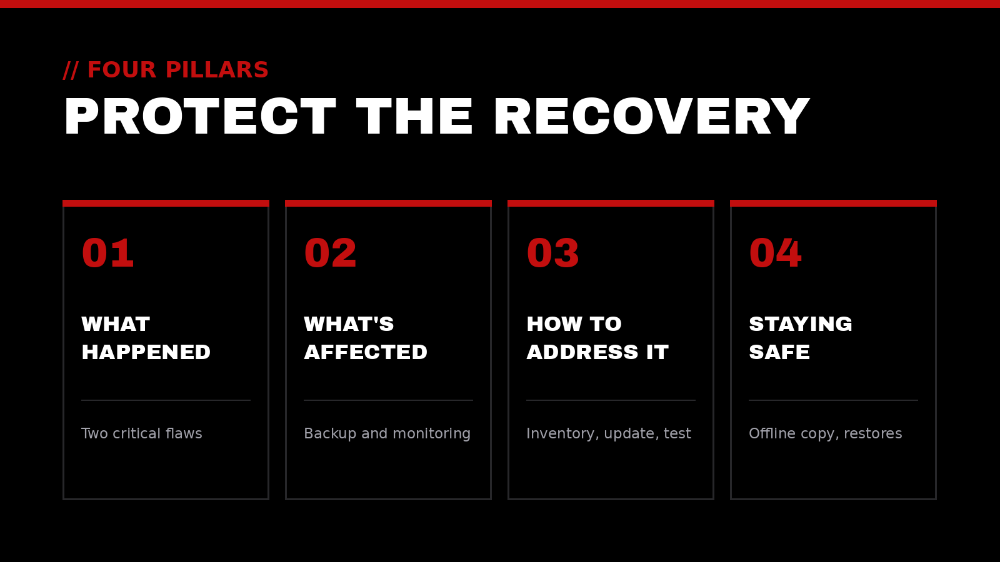
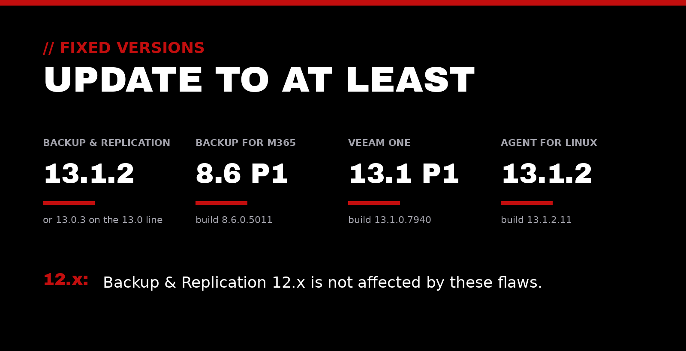

When something goes terribly wrong, whether that's ransomware, a failed server, or an accidental deletion, backups are what let an organization recover. That's exactly why attackers go after them. If the backups are gone, encrypted, or quietly tampered with, recovery gets much harder.

This week, Veeam, one of the most widely used backup and recovery platforms, published fixes for several vulnerabilities, including two rated critical. Here's our plain-language breakdown in four parts.

## // 01 What happened

On October 27, Veeam published security bulletins for three products: **Backup & Replication 13**, **Backup for Microsoft 365**, and **Veeam ONE**, its monitoring tool. The [Canadian Centre for Cyber Security](https://www.cyber.gc.ca/en/alerts-advisories/veeam-security-advisory-av26-1096) followed on October 28 with an advisory urging organizations to update.

The two most serious issues:

- **CVE-2026-108142** ([Veeam KB4948](https://www.veeam.com/kb4948)), Critical, 9.1 (CVSS v4.0): someone *without any login* could get around access checks on the CDP Coordinator Service in Backup & Replication. That's the component behind continuous data protection.
- **CVE-2026-106076** ([Veeam KB4957](https://www.veeam.com/kb4957)), Critical, 9.0 (CVSS v4.0): in Backup for Microsoft 365, an attacker in control of a connected partner server (one used to move organizations between backup servers) could inject database commands. That could expose or change settings across tenants and run code on the backup server.

Veeam also fixed lower-severity issues, including file-writing flaws limited to users with the Restore Operator role, a privilege escalation in Veeam Agent for Linux, and a flaw in Veeam ONE ([KB4951](https://www.veeam.com/kb4951)) that let someone who already has an administrator's password switch off multi-factor authentication before finishing the MFA check.

**Is anyone exploiting these yet?** Veeam's bulletins don't report any attacks, and none of these flaws were on CISA's [Known Exploited Vulnerabilities catalog](https://www.cisa.gov/known-exploited-vulnerabilities-catalog) as of its October 29 update. But history is a reason to move quickly: that catalog already lists four older Backup & Replication flaws, and CISA marks all four as used in ransomware campaigns. Veeam itself warns that once a patch is public, attackers try to reverse-engineer it.

*Update on our last security post:* CISA has since [confirmed active exploitation](https://www.cisa.gov/news-events/alerts/2026/10/26/cisa-adds-two-known-exploited-vulnerabilities-catalog) of the two critical PHP flaws we covered last week. If your PHP servers aren't updated yet, put them at the top of the list too.

## // 02 What's affected

| Product | What it does | Affected | Fixed in |
|---|---|---|---|
| Backup & Replication 13 | Backs up and restores servers, virtual machines, and file shares | 13.1.1.18 and earlier 13.1 builds; 13.0.2.29 and earlier 13.0 builds | 13.1.2 (13.1.2.57) or 13.0.3 (13.0.3.63) |
| Veeam Agent for Linux | Backs up individual Linux machines | 13.1.1.4 and earlier 13.1 builds, when managed by Backup & Replication | 13.1.2 (13.1.2.11) |
| Backup for Microsoft 365 | Backs up Exchange Online, SharePoint, OneDrive, and Teams | 8.5.0.1014 and earlier for the critical flaw; 8.6.0.1102 and earlier for two medium flaws | 8.6 Patch 1 (8.6.0.5011) |
| Veeam ONE | Monitors and reports on the backup environment | 13.1.0.7233 and earlier 13.1 builds | 13.1 Patch 1 (13.1.0.7940) |

A few notes from Veeam's bulletins:

- **Backup & Replication 12.x is not affected** by this week's Backup & Replication flaws, and Veeam ONE 13.0.x and 12.x are not affected by the MFA flaw.
- **Backup for Microsoft 365:** the critical fix actually arrived in version 8.6 back in September. Veeam only published the details this week. Any server still on 8.5 or older now has a publicly documented flaw. Veeam also says unsupported versions weren't tested and should be treated as vulnerable.
- **Managed or hosted backups:** if a provider runs Veeam for you, the update is on their side, but it's still worth confirming it happened.

## // 03 How to address it

1. **Find every Veeam component.** Backup servers, proxies, Linux agents, the Microsoft 365 backup server, and Veeam ONE are often installed at different times by different people.
2. **Check the build number** of each one against the table above.
3. **Confirm your last backups finished cleanly** before you update, so you have a known-good restore point.
4. **Update to the fixed builds.** Veeam Updater can apply Backup & Replication patches; the installation media is also available from your Veeam account. Backup for Microsoft 365 can go straight to 8.6 Patch 1 from any version 8 release.
5. **Run a test job afterward**, then confirm the new build number and that scheduled jobs are running.
6. **On Veeam ONE,** after updating, check that MFA is still turned on. Look into it if it was switched off without explanation.
7. **If you can't update today,** limit who and what can reach the backup server over the network, and watch its logs closely until you can.

## // 04 Staying safe going forward

- **Keep at least one copy out of reach.** CISA's [ransomware guidance](https://www.cisa.gov/stopransomware/ransomware-guide) recommends offline, encrypted backups of critical data. A copy that attackers can't reach or change is the one that saves you.
- **Treat the backup system as critical infrastructure.** Give it its own administrator accounts, require MFA, and keep it off the everyday network where possible. Whoever controls the backups controls your recovery.
- **Test restores, not just backups.** CISA advises regularly testing that backups are available and intact. A green "success" status isn't the same as a restore you've actually completed.
- **Patch the safety net on a rhythm.** Backup software is easy to "set and forget." Put it on the same regular update schedule as your servers, with a fast path for critical fixes like these.
- **Keep an inventory.** Know which backup products and versions you run, who manages each one, and when support for each version ends.

> Good stewardship means protecting the safety net, not just the systems it catches.

## How Top-Notch Network helps

We exist to elevate those who elevate the world. In practice, that means helping service-driven leaders and organizations keep their systems patched, secure, and dependable:

- **IT & Cloud Consulting:** infrastructure that's reliable, secure, and built to support the mission, including backup and recovery
- **Cybersecurity Auditing:** a clear picture of where you're exposed, including who can reach and change your backups
- **AI & Automation:** thoughtfully adopting AI tools and automations that remove noise, with sensible guardrails
- **Executive Leadership Coaching:** supporting the leader who supports everyone else

## Let's talk

If you're not sure which backup versions you're running, or whether you could actually restore from them today, we'd be glad to help you check. We offer a trusted outside perspective to help your impact reach the next level.

Reach out anytime at [contact@top-notchnetwork.com](mailto:contact@top-notchnetwork.com).
